# Small Office Network Lab: VLANs, DHCP, and a Firewall in GNS3

A small office network built in GNS3 with an OPNsense firewall, an Ethernet switch, and three VLANs (Staff, Servers, Guest). The firewall hands out DHCP addresses, routes between the zones, and enforces a default-deny rule set. I tested every allowed and blocked path, then broke the network three ways on purpose and diagnosed and fixed each problem.

This is a personal home-lab project on my own PC. It is not production or work experience.

## What this project shows

- Segmenting one switch into separate zones with VLANs and an 802.1Q trunk to the firewall
- Running DHCP per zone, so each VLAN gets its own address pool, gateway, and DNS server
- Writing default-deny firewall rules with an alias, and understanding that rules are checked top to bottom, first match wins
- Proving a rule set works by testing the blocked paths too, and reading the firewall log to confirm why something was blocked
- Troubleshooting from symptoms to cause: wrong VLAN, wrong gateway, and a firewall rule in the wrong place
- Keeping lab work safe with configuration backups and VM snapshots

## Topology

```
                 PC browser
                     |   management, 192.168.56.0/24
                     |   (through a GNS3 Cloud node)
                     |
Internet --- NAT --- OPNsense firewall   DHCP, routing, firewall rules
                     |
                     |   trunk: VLANs 10, 20, 30
                     |
               Ethernet switch
              /        |        \
         VLAN 10    VLAN 20    VLAN 30
         PC-Staff   Server1    PC-Guest
```

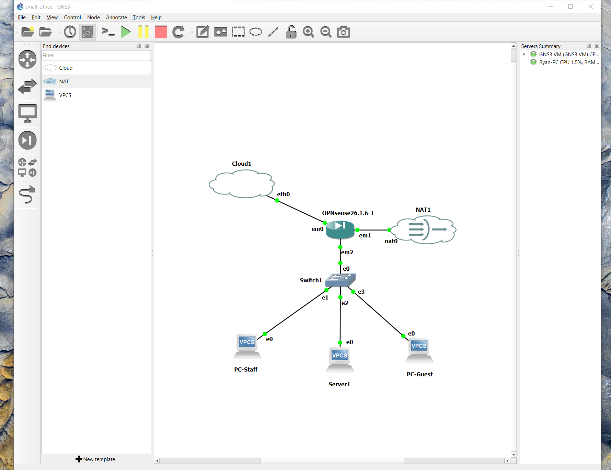

*The lab topology in GNS3: an OPNsense firewall with a management link, an internet (NAT) link, and a trunk to a switch carrying VLANs 10, 20, and 30 to three test hosts.*

## Environment

| Component | Version and settings |
|---|---|
| Host | Windows 10 PC with 16 GB RAM, VirtualBox 7.2.22 |
| GNS3 | 2.2.61, with the GNS3 VM 2.2.61 running in VirtualBox (2 vCPUs, 6 GB RAM, nested virtualization on) |
| Firewall | OPNsense 26.1.6 (nano image) as a GNS3 QEMU node (1 vCPU, 2 GB RAM, 4 virtio network adapters) |
| Switch | GNS3 built-in Ethernet switch |
| Hosts | Three VPCS 0.8.3 virtual PCs |
| DHCP and DNS | Dnsmasq DHCP on the firewall, which is OPNsense's default in this version |

## Addressing

### Zones

| Zone | VLAN | Subnet | Gateway (firewall) | DHCP pool |
|---|---|---|---|---|
| Staff | 10 | 10.10.10.0/24 | 10.10.10.1 | 10.10.10.100 to 10.10.10.199 |
| Servers | 20 | 10.10.20.0/24 | 10.10.20.1 | 10.10.20.100 to 10.10.20.199 |
| Guest | 30 | 10.10.30.0/24 | 10.10.30.1 | 10.10.30.100 to 10.10.30.199 |

I picked `10.10.x.x` so the lab does not overlap with the other ranges on my PC (VirtualBox's NAT and host-only networks, and my Active Directory lab).

### Firewall interfaces

| GNS3 port | OPNsense device | Name | Role | Address |
|---|---|---|---|---|
| em0 | vtnet0 | LAN | Management (web GUI), not a user network | 192.168.56.10/24 (static) |
| em1 | vtnet1 | WAN | Internet through the GNS3 NAT node | DHCP, 192.168.42.0/24 |
| em2 | vtnet2 | (trunk) | Carries the VLAN 10, 20, and 30 tags | none |
| n/a | vlan01 | Staff | VLAN 10 on vtnet2 | 10.10.10.1/24 |
| n/a | vlan02 | Servers | VLAN 20 on vtnet2 | 10.10.20.1/24 |
| n/a | vlan03 | Guest | VLAN 30 on vtnet2 | 10.10.30.1/24 |
| em3 | vtnet3 | (spare) | Unused | none |

GNS3 labels the firewall's ports `em0`, `em1`, and so on. Inside OPNsense the same ports appear as `vtnet0`, `vtnet1`, and so on.

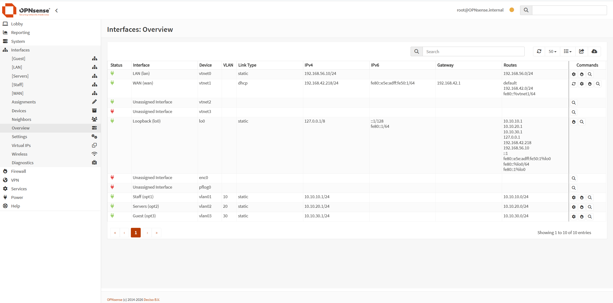

*OPNsense interface overview: LAN is the management port (vtnet0), WAN gets its address from the NAT node (vtnet1), and Staff, Servers, and Guest are VLAN 10, 20, and 30 interfaces on the trunk port (vtnet2), each with a gateway address.*

### Switch ports

| Switch port | Mode | VLAN | Connected to |
|---|---|---|---|
| 0 | dot1q (trunk) | 1 (native) | Firewall, em2 |
| 1 | access | 10 | PC-Staff |
| 2 | access | 20 | Server1 |
| 3 | access | 30 | PC-Guest |

### Management path

OPNsense is configured through its web page, so my PC needed a way to reach it. I connected the firewall's first port to a GNS3 Cloud node bound to the GNS3 VM's host-only network, which my PC was already on. It works like a dedicated management port on a real firewall. VirtualBox needed the host-only adapter's Promiscuous Mode set to "Allow All" before traffic would pass.

### DHCP

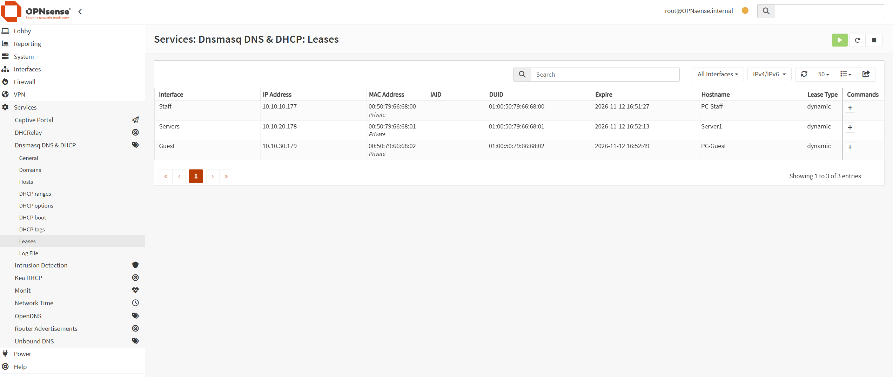

*DHCP leases handed out by the firewall. Each host received an address from its own zone's pool: Staff in 10.10.10.x, Servers in 10.10.20.x, and Guest in 10.10.30.x.*

## Firewall rules

I made one alias, `PrivateNets`, containing `10.0.0.0/8`, `172.16.0.0/12`, and `192.168.0.0/16`. "Anything not in PrivateNets" is how the rules say "the internet" without also opening the other zones or the management network.

Rules sit on the interface where traffic enters the firewall, and are checked top to bottom. The first match wins, and anything not explicitly passed is blocked. Replies to allowed traffic are handled automatically because the firewall is stateful.

**Staff**

| # | Action | Protocol | Source | Destination | Purpose |
|---|---|---|---|---|---|
| 1 | Pass | TCP/UDP | Staff net | Staff address, port 53 | DNS from the firewall |
| 2 | Pass | ICMP | Staff net | Staff address | Ping the firewall |
| 3 | Pass | any | Staff net | Servers net | Reach the servers |
| 4 | Pass | any | Staff net | not PrivateNets | Reach the internet |

**Servers**

| # | Action | Protocol | Source | Destination | Purpose |
|---|---|---|---|---|---|
| 1 | Pass | TCP/UDP | Servers net | Servers address, port 53 | DNS from the firewall |
| 2 | Pass | ICMP | Servers net | Servers address | Ping the firewall |
| 3 | Pass | any | Servers net | not PrivateNets | Reach the internet |

**Guest**

| # | Action | Protocol | Source | Destination | Purpose |
|---|---|---|---|---|---|
| 1 | Pass | TCP/UDP | Guest net | Guest address, port 53 | DNS from the firewall |
| 2 | Pass | ICMP | Guest net | Guest address | Ping the firewall |
| 3 | Pass | any | Guest net | not PrivateNets | Reach the internet |

There are no explicit block rules. Everything else is stopped by the default deny, including every zone's access to the management address `192.168.56.10`.

*Firewall rules for each zone. Rules are checked top to bottom, and anything not explicitly allowed is blocked. Staff can reach Servers and the internet, while Servers and Guest can reach only the internet.*

<details>
<summary>Screenshots of the rules in OPNsense (Staff, Servers, Guest)</summary>

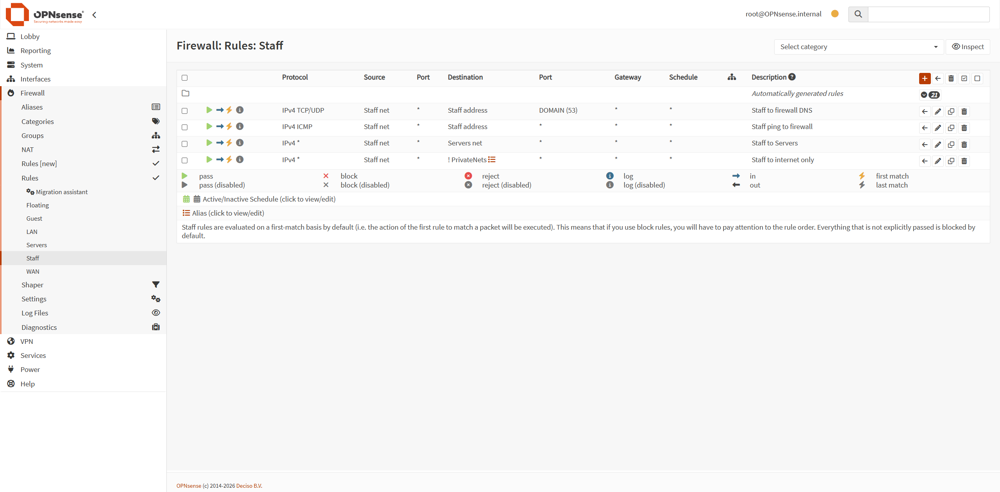

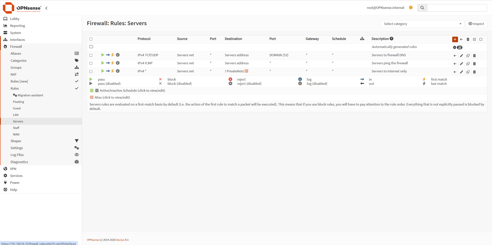

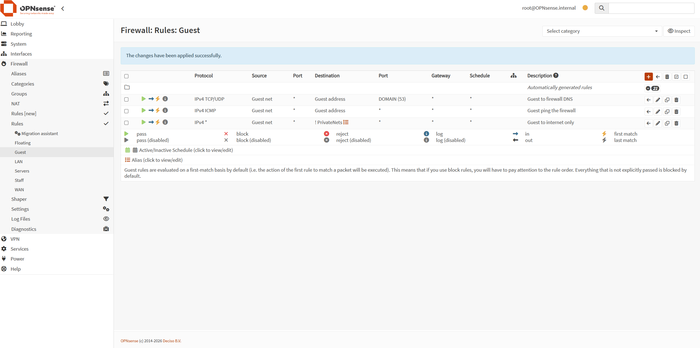

</details>

## Verification

I ran one ping per path from each host. Every host could also ping its own gateway.

| From | To Staff | To Servers | To Guest | To the internet (8.8.8.8 and google.com) | To the management address (192.168.56.10) |
|---|---|---|---|---|---|
| **Staff** | n/a | Reply | Blocked (timeout) | Reply | Blocked (timeout) |
| **Servers** | Blocked (timeout) | n/a | Blocked (timeout) | Reply | Blocked (timeout) |
| **Guest** | Blocked (timeout) | Blocked (timeout) | n/a | Reply | Blocked (timeout) |

All results matched the plan. Tests used ping (ICMP) plus DNS name resolution only. I did not test other applications.

*Ping tests from each zone. Staff reaches Servers and the internet. Servers and Guest reach only the internet, and every other path times out because the firewall blocks it.*

<details>
<summary>Screenshots of the ping tests (Staff, Servers, Guest)</summary>

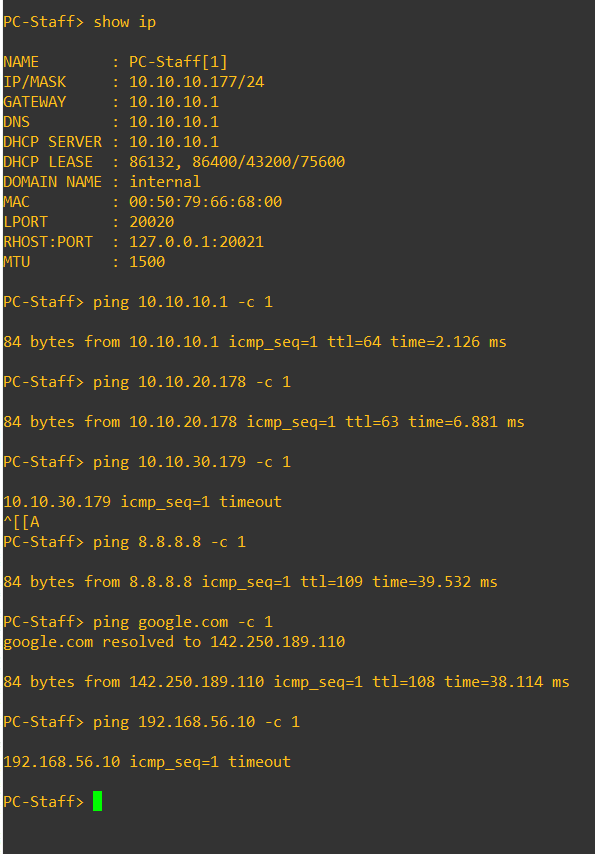

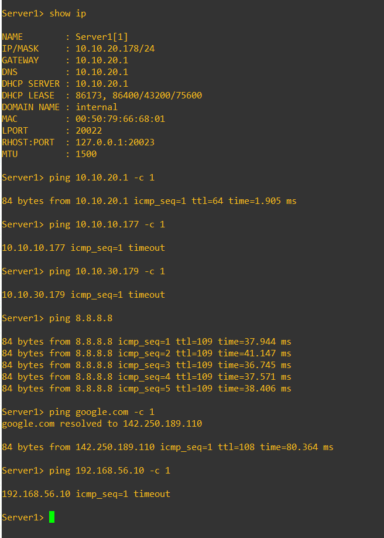

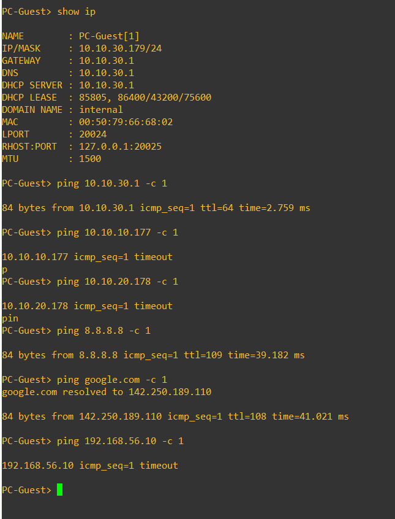

</details>

A timeout alone does not prove the firewall caused it, so I also checked the firewall's live log while pinging from the Guest zone:

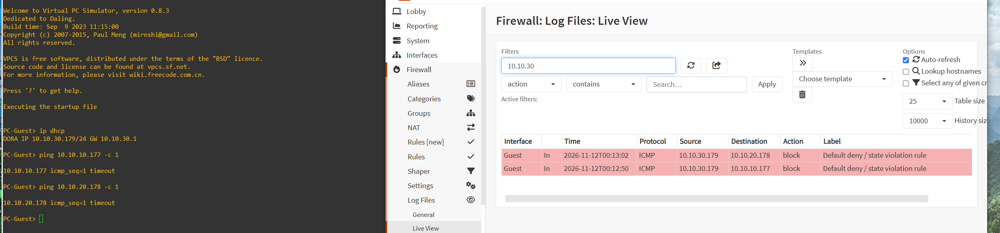

*The firewall's live log showing PC-Guest's attempts to reach the Staff and Servers zones being blocked by the default deny rule.*

## Break/fix scenarios

For each one, I broke the network on purpose, wrote down the symptom as a help desk ticket, diagnosed it from the evidence, fixed it, and proved the fix.

### Scenario 1: Wrong VLAN

**Ticket:** "The internet works, but I can't reach the file server."

**How I broke it:** I set PC-Staff's switch port to VLAN 30 instead of VLAN 10.

**Symptom:** After `ip dhcp`, PC-Staff received `10.10.30.177/24` with gateway `10.10.30.1`. A ping to Server1 timed out, and a ping to 8.8.8.8 worked.

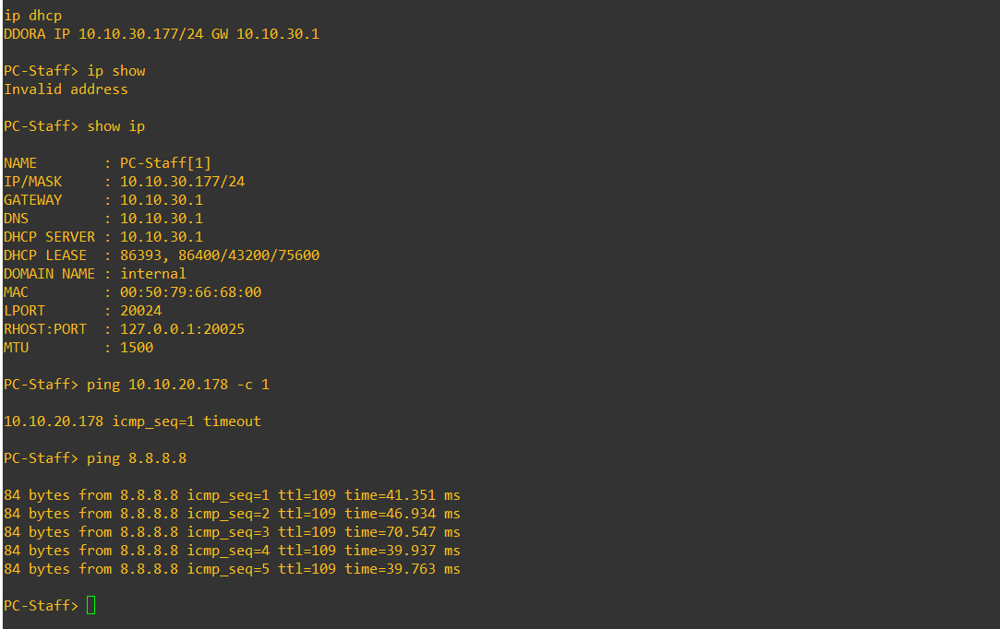

*Scenario 1, wrong VLAN: PC-Staff's switch port is set to VLAN 30, so it receives a Guest address. The internet still works but the Servers zone is unreachable.*

**Diagnosis:** The address came from the Guest pool, not the Staff pool, so the host was in the wrong VLAN. The internet still worked because the Guest zone is allowed out, and Servers was unreachable because Guest has no path to it.

**Fix:** I set the switch port back to VLAN 10 and ran `ip dhcp` again. PC-Staff received `10.10.10.177/24`, and both pings replied.

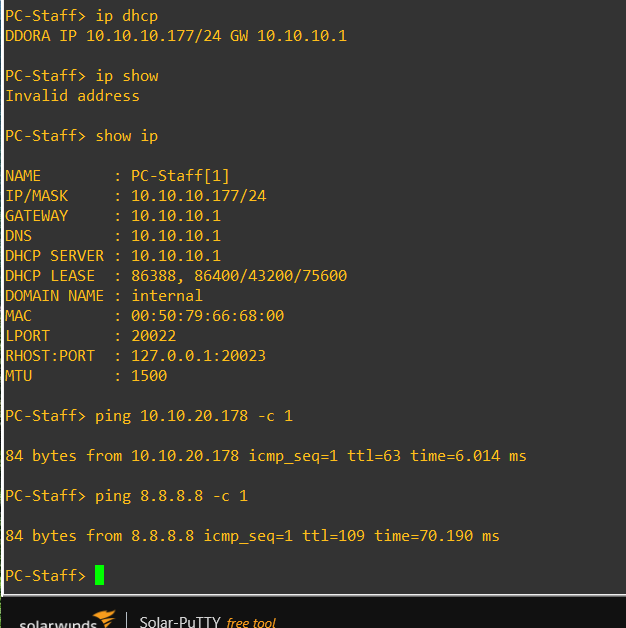

*Scenario 1, fixed: with the switch port back on VLAN 10, PC-Staff receives a Staff address and can reach both the Servers zone and the internet.*

**Takeaway:** Check the address first. An address from the wrong pool points at the switch port. "The internet works" can hide a wrong-zone problem.

### Scenario 2: Wrong gateway

**Ticket:** "I can reach the network, but nothing past it."

**How I broke it:** I gave PC-Staff a static address with a gateway that does not exist: `ip 10.10.10.50/24 10.10.10.254`.

**Symptom:** A ping to the firewall (`10.10.10.1`) replied. Pings to Server1 and to 8.8.8.8 both printed `host (10.10.10.254) not reachable`.

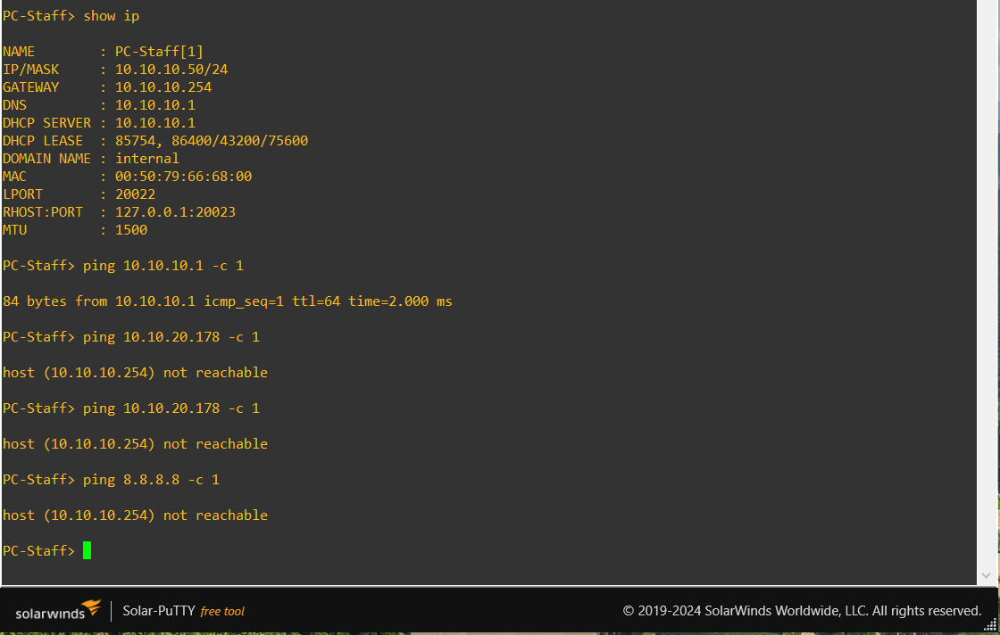

*Scenario 2, wrong gateway: PC-Staff has a static address with a gateway that doesn't exist. It can still reach the firewall on its own subnet, but anything beyond reports "not reachable" because nothing answers at the gateway address.*

**Diagnosis:** The host could reach the firewall next door but nothing beyond it, which points at the gateway setting. The message names the gateway address, and `show ip` showed `.254` where the firewall hands out `.1`. A plain "timeout" would have meant the packet left and something dropped it. "Not reachable" means VPCS could not even reach the gateway, most likely because nothing on the subnet answers at that address.

**Fix:** I set the gateway to the firewall's Staff address: `ip 10.10.10.50/24 10.10.10.1`. All three pings replied.

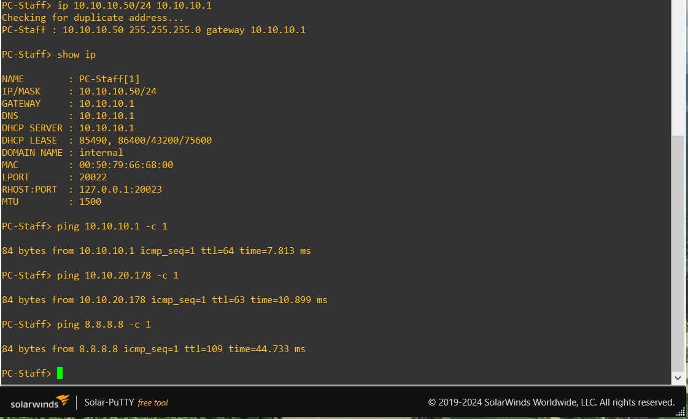

*Scenario 2, fixed: with the gateway set to the firewall's Staff address, PC-Staff reaches the Servers zone and the internet again.*

**Takeaway:** A host that can reach its gateway but nothing beyond it usually has a gateway problem. The error text can tell you which address to check.

### Scenario 3: A firewall rule that blocks too much

**Ticket:** "Since this morning I can't reach the file server. The internet is fine."

**How I broke it:** I added a block rule on the Staff interface for traffic from Staff net to Servers net. When I first added it at the bottom of the list, it didn't block anything, because the "Staff to Servers" pass rule above it matched first. I moved the block rule to the top.

**Symptom:** PC-Staff had a correct address and gateway. Pings to the firewall and to 8.8.8.8 replied, and the ping to Server1 timed out.

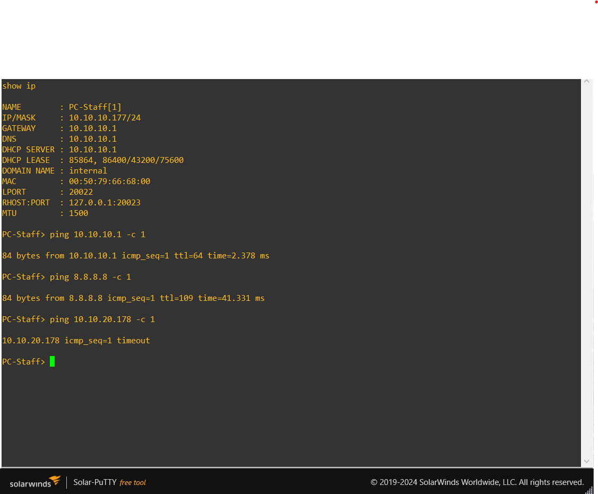

*Scenario 3, a firewall rule blocking too much: PC-Staff has the correct address and gateway and reaches the internet, but the Servers zone times out.*

**Diagnosis:** The address and gateway were correct and only one destination failed with a plain timeout, so the packet was leaving the host and being dropped on the way. I filtered the firewall's live log to blocked traffic and pinged Server1 again. The log showed the exact rule that blocked it.

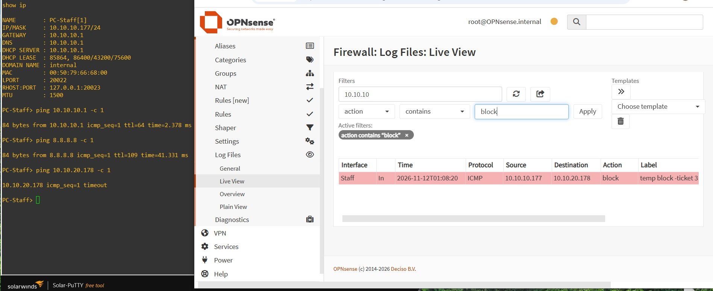

*Scenario 3, diagnosis: the firewall's live log shows PC-Staff's ping to the Servers zone blocked by the temporary rule at the top of the Staff list. The log names the exact rule responsible.*

**Fix:** I deleted the temporary rule and applied the change. All three pings replied.

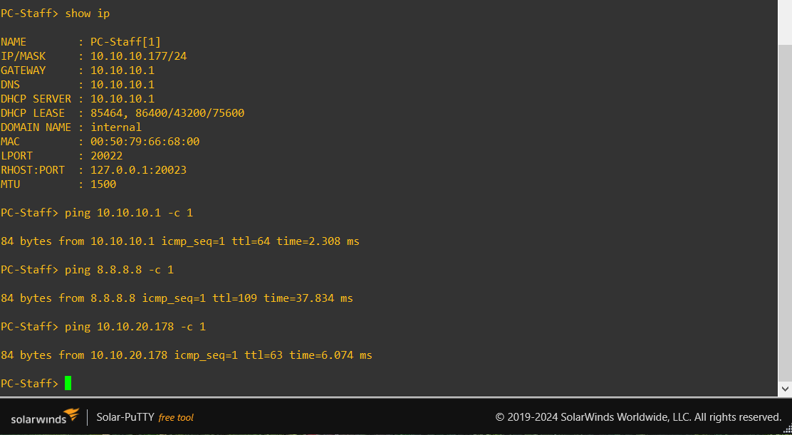

*Scenario 3, fixed: after the temporary block rule is deleted, PC-Staff reaches the Servers zone and the internet again.*

**Takeaway:** Firewall rules are checked top to bottom and the first match wins. A block rule placed below an allow rule that matches the same traffic does nothing, and the firewall log names the rule that fired.

## Problems I ran into

| Problem | Cause | Fix |
|---|---|---|
| I could not reach the OPNsense web page from my PC (pings timed out) | VirtualBox only passes traffic for a VM's own MAC address, and the firewall has its own | Set Promiscuous Mode to "Allow All" on the GNS3 VM's host-only adapter |
| After a restart of the GNS3 VM, GNS3 showed "not found" errors for the nodes | The server had restarted and forgotten the running nodes, so the GUI was out of sync | Quit and reopened GNS3 |
| The GNS3 VM would not start after a VirtualBox update (`VERR_INTNET_FLT_IF_NOT_FOUND`) | The update reset VirtualBox's virtual network adapters | Restarted Windows |
| Hosts had no connectivity after I restarted the lab | VPCS does not keep its DHCP address across restarts | Ran `ip dhcp` on each host after every start |
| The GNS3 VM crashed several times while the firewall was running (VirtualBox "Guru Meditation") | The VirtualBox log showed an internal error in its memory-management code while running a nested guest (the firewall runs inside the GNS3 VM, which runs inside VirtualBox) | I did not find a fix. Updating VirtualBox from 7.2.8 to 7.2.22 and lowering the GNS3 VM from 4 vCPUs to 2 did not stop it. I worked around it with configuration backups, VM snapshots, stopping the firewall when idle, and short work sessions |

## Limitations

- The hosts are VPCS virtual PCs. They can ping and use DHCP and DNS, but they run no real services, so "Server1" is a stand-in.
- Testing covered ping and DNS name resolution only, not application traffic.
- IPv6 was not configured.
- The management path runs over a VirtualBox host-only network, which is not what a production out-of-band network looks like.
- Nested virtualization was unstable on my hardware, as described above.

## Not in this repo

- GNS3 project files and VM disks, which are large
- The OPNsense configuration backup, because it contains password hashes and keys

## Next ideas

- Put a real server in the Servers zone, such as my Active Directory server or a simple web server, and test application traffic instead of only ping
- Capture traffic on the trunk with Wireshark to see the VLAN tags
- Add IPv6 addressing and matching firewall rules
